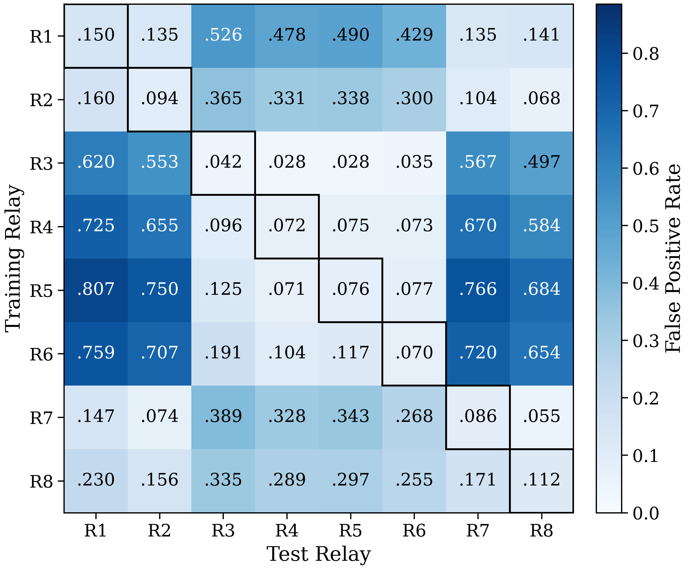

# Characterizing Cross-Relay Generalization Failure in ML-Based Power System Protection

Code for the paper **"Characterizing Cross-Relay Generalization Failure in Machine Learning-Based Power System Protection"** (IEEE PESS 2026) by Nithin Pradeep Nadayil Kizhakkethil, Julian Oelhaf, Christian Bergler, Andreas Maier and Siming Bayer.

A fault detector trained at one protective relay and applied at another keeps almost the same F1-score (0.730 within-relay vs. 0.734 cross-relay), but its false-positive rate rises from 0.088 to 0.341. The change is structured by location: models trained at Bus 2 relays reach a mean FPR of 0.670 at Bus 1 and Bus 3 relays, compared with 0.096 for transfers within the same bus group.



## Main results

Mean ± std over five seeds, 64 source–target relay pairs (8 self, 56 cross):

| Metric | Self | Cross | Worst cross pair |
|---|---|---|---|
| Accuracy | 0.7010 ± 0.0069 | 0.6747 ± 0.0059 | 0.5734 ± 0.0232 |
| F1 | 0.7302 ± 0.0095 | 0.7336 ± 0.0098 | 0.5747 ± 0.0441 |
| ROC AUC | 0.7929 ± 0.0058 | 0.7493 ± 0.0070 | 0.6809 ± 0.0052 |
| FPR | 0.0879 ± 0.0134 | 0.3406 ± 0.0379 | 0.9081 ± 0.0908 |
| FNR | 0.3986 ± 0.0159 | 0.3181 ± 0.0256 | 0.5727 ± 0.0568 |

Representation analysis (seed 42): relay identity is only weakly recoverable from the penultimate layer (probe accuracy 0.266, chance 0.125), while bus-group identity is more recoverable (0.709, majority baseline 0.50). Class-conditional MMD² shows no consistent monotonic association with transfer errors; it is a diagnostic, not an explanation. See the paper for details and limitations.

## Setup

- **Data:** AdaptGrid subset of EvEMTBench (Kordowich et al., 2026): a simulated 110 kV double-line network with eight transmission-line relays, six channels per relay (3-phase currents and voltages) at 9.6 kHz. Windows are 50 ms (480 × 6) with a 5 ms step; switching events are excluded.
- **Task:** binary detection of a fault anywhere in the network from local relay measurements (not zone-selective tripping).
- **Model:** MLP, 2880 → 256 → 128 → 1 (ReLU), trained on raw measurements without normalization. Adam, learning rate 1.38e-4, batch size 1024, at most 200 epochs, early stopping with patience 20, `BCEWithLogitsLoss`.
- **Threshold:** selected on the source relay's validation set by maximizing Youden's J, then frozen for all target relays.
- **Split:** one shared simulation-level split (seed 42): 3,266 / 700 / 701 simulations for train / validation / test. Experiments use seeds 42, 5, 10, 25 and 100.

## Reproducing

```bash
conda env create -f environment.yml    # or: pip install -r requirements.txt
export EVENTBENCH_DATASET_DIR=/path/to/evemtbench/adapt_grid
python -m scripts.train --model compact_mlp --methodology pairwise --training default
python -m scripts.plot_results --experiment compact_mlp_pairwise_default
```

On a Slurm cluster, submit from the repository root:

```bash
sbatch slurm/run_python.sh scripts.train --model compact_mlp --methodology pairwise --training default
```

The paper reports five seeds (42, 5, 10, 25, 100). Train one model set per seed, then summarize across seeds:

```bash
for seed in 42 5 10 25 100; do
  sbatch slurm/run_python.sh scripts.train --model compact_mlp --methodology pairwise --training default --seed $seed
done
```

When the jobs have finished, run the analysis for each seed's run folder (the timestamped directory under `results/compact_mlp_pairwise_default/`). This computes the source-validation threshold analysis that the summary needs. The t-SNE/MMD/probe analysis is only used for the seed-42 run in the paper, so for the other seeds it can be skipped:

```bash
python -m scripts.plot_results --experiment compact_mlp_pairwise_default \
    --run-dir results/compact_mlp_pairwise_default/<run-timestamp> --skip-representation
```

Then summarize across seeds:

```bash
python -m scripts.multi_seed_threshold_summary_updated
```

The summary script reads `results/compact_mlp_pairwise_default/` and writes the five-seed mean and standard deviation tables and heatmaps to `multi_seed_threshold_summary/`.

Data loading depends on `psp_helper`, an internal package of the Pattern Recognition Lab (FAU) that loads the EvEMTBench simulation data and extracts the windowed relay measurements used here. It is not publicly available, so the scripts cannot be run end to end from this repository alone; the code is provided to document the method and experiments.

Results are written to `results/` (not tracked in this repository).

## Scope

This repository supports the paper's controlled experiment: one simulated network, one MLP baseline and a global fault-state label. The magnitudes of the effects should not be generalized to other architectures or networks.

## Acknowledgments

Funded by the Deutsche Forschungsgemeinschaft (DFG, German Research Foundation), project 535389056. The authors gratefully acknowledge the scientific support and high-performance computing resources provided by NHR@FAU under NHR project b304dc.

## Citation

A citation entry will be added when the proceedings are available.

## License

MIT, see `LICENSE`. The dataset and helper package remain under their own licenses.